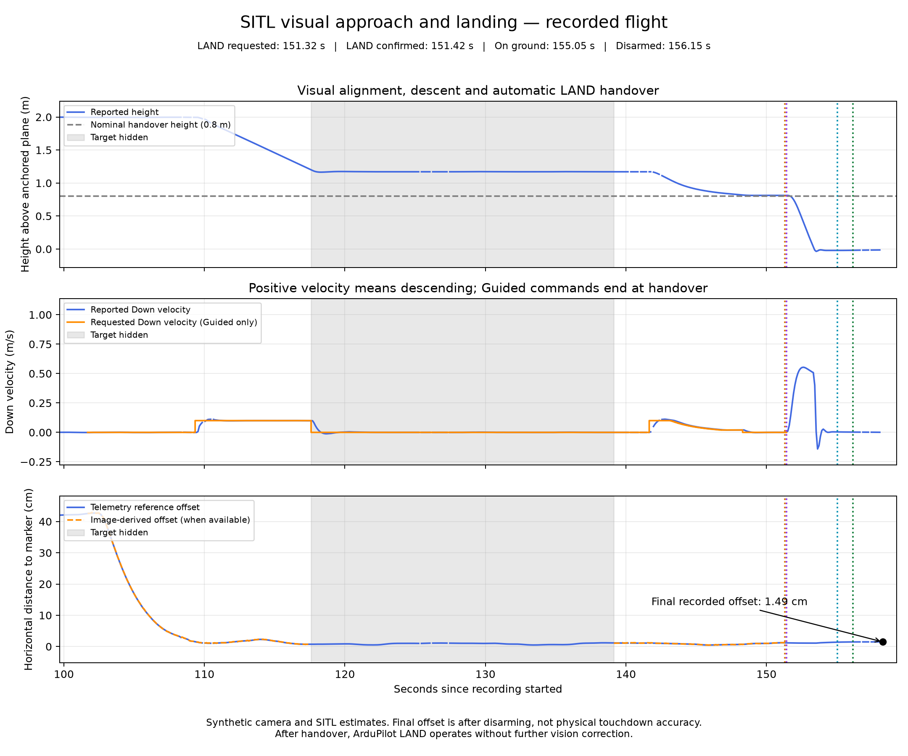

# Vision-Based Drone Alignment and Landing in ArduPilot SITL

This project uses Python and OpenCV to detect a landing marker, align a simulated drone above it, descend, and hand over to ArduPilot LAND. It records telemetry and confirms ground contact status and disarming before reporting success.

The work has two separate parts: real webcam marker tests and flight-control tests using a synthetic camera with ArduPilot Software-in-the-Loop (SITL). No physical drone was flown for this project. Takeoff is manual; the approach, descent and LAND handover are automated after the operator enables the script.

## Final flight



Two completed LAND-handover runs recorded final simulated horizontal offsets of **2.06 cm** and **1.49 cm**. These are telemetry-based offsets after disarming, not physical touchdown accuracy. See [RESULTS.md](RESULTS.md) for the test conditions and limitations.

## What it does

- Detects an ArUco marker and estimates its position using OpenCV.
- Uses camera calibration for separate webcam distance checks.
- Renders a downward-facing virtual camera from live SITL position and attitude.
- Converts the image-derived target position into North/East/Down coordinates.
- Sends limited velocity commands for alignment and descent.
- Requests zero velocity when the target is lost and confirms the target again before resuming.
- Checks the low hover before requesting LAND.
- Stops Guided velocity commands after LAND handover.
- Records flight data, landing events, disarming and final simulated offset.

## How it works

```text
SITL position and attitude -> synthetic camera image -> marker detection
                                                      |
                                               position estimate
                                                      |
                                           alignment/descent controller
                                                      |
                                           MAVLink velocity commands
                                                      |
                                                  ArduPilot

Low-hover checks -> LAND request -> LAND confirmation -> on ground -> disarmed
```

Telemetry supplies the scene geometry and reference measurements. The approach controller uses the target estimated from the rendered image, together with attitude information. Telemetry height is also used as a guard. The renderer and estimator share ideal camera assumptions, so this is not an independent real-camera flight validation.

After handover, ordinary ArduPilot LAND completes the descent. This version does not send `LANDING_TARGET` messages and does not apply vision corrections during LAND.

## Tools and equipment

- Windows laptop, Intel Core i5-1155G7, approximately 16 GB RAM.
- Laptop webcam and phone/tablet displaying calibration and marker images.
- Python, OpenCV, NumPy, pymavlink and Matplotlib.
- Mission Planner 1.3.83 and ArduCopter 4.8.0 development build, as displayed during testing.

Recorded package versions: OpenCV-contrib 5.0.0.93, NumPy 2.5.4, pymavlink 2.4.50 and Matplotlib 3.11.2. Development firmware and software changes may affect reproduction; these results describe the tested setup.

## Main files

Keep the Python files together in the project root because scripts import shared modules from that location.

| File | Purpose |
|---|---|
| `sitl_land_handover.py` | Final alignment, descent and LAND-handover demonstration |
| `sitl_camera_preview.py` | Synthetic camera rendering and coordinate transforms |
| `virtual_marker_pose.py` | Synthetic marker position estimation |
| `check_sitl_connection.py` | Check reception of autopilot telemetry |
| `plot_final_landing.py` | Plot the final CSV and matching JSON |
| `sitl_controlled_descent.py` | Earlier descent-to-hover test |
| `analyze_sitl_descent.py` | Review target-loss motion in descent logs |
| `plot_sitl_descent.py` | Plot descent tests |
| `sitl_visual_alignment.py` | Earlier horizontal alignment test |
| `generate_marker.py`, `detect_marker.py` | Webcam marker detection stage |
| `generate_checkerboard.py`, `capture_calibration.py`, `calibrate_camera.py` | Camera calibration stage |
| `estimate_marker_position_v2.py`, `analyze_distance_checks.py` | Webcam distance checks and analysis |

Flight CSV and JSON files are saved in `sitl_landing_logs/`. Final graphs are saved in `sitl_landing_plots/`.

## Setup for the final SITL demonstration

Use this controller only with the simulator. It has not been validated for physical flight.

In PowerShell, open the project folder. If creating a new environment:

```powershell
py -m venv .venv
.\.venv\Scripts\python.exe -m pip install -r requirements.txt
```

If an environment already exists, use it. Install one OpenCV package with ArUco support, rather than multiple competing OpenCV packages.

1. Open Mission Planner's Simulation page.
2. Select the quad model and simulation speed 1. Leave Wipe unchecked for the existing setup.
3. In the extra command-line field, use `--serial1=udpclient:127.0.0.1:14600`.
4. Start the multirotor simulator and wait for telemetry. Mission Planner uses its TCP connection; Python listens on UDP port 14600.
5. Close other Python programs using that UDP port. Run only one controller at a time.

Run the offline checks first:

```powershell
.\.venv\Scripts\python.exe .\sitl_land_handover.py --self-test
```

These checks exercise software logic. They do not perform a live SITL flight.

## Run the final demonstration

1. Start with the simulated vehicle on the ground and disarmed.
2. Run:

```powershell
.\.venv\Scripts\python.exe .\sitl_land_handover.py
```

3. Wait for `GROUND ANCHORED` in PowerShell.
4. In Mission Planner, select Guided mode, arm, and use the map's Takeoff command to take off to **2 m**.
5. Once hovering, click the Python preview window and press **Space** to enable alignment and descent.
6. For a target-loss test, press **H** during descent to hide the marker. Press **H** again to restore it. The script requests zero velocity while the target is missing; the vehicle may still move while braking.
7. Allow the low-hover check and automatic LAND handover to finish. Do not select LAND manually during a normal test.
8. Look for `SUCCESS - ON GROUND AND DISARMED`. The program saves CSV and JSON files and closes.

| Key | Behaviour |
|---|---|
| Space | Start/pause before handover |
| H | Hide/show the synthetic marker |
| Q | Exit; does not itself request landing. Before handover it requests zero velocity if it owns Guided control. After handover, ArduPilot LAND continues. |

If the program exits without confirmed success, check Mission Planner and land any ongoing simulated flight manually. Zero-velocity requests are not an immediate physical stop or a substitute for a flight-controller failsafe.

## Plot a saved run

Keep the CSV and matching JSON together. For the documented target-loss run:

```powershell
.\.venv\Scripts\python.exe .\plot_final_landing.py .\sitl_landing_logs\landing_20261110_204642_733626.csv
```

The graph shows height, requested/reported downward velocity, horizontal offset, target-loss shading and landing events. PNG and PDF outputs are saved automatically. Replace the filename to plot another run.

## Webcam tests are separate

The webcam stage used a measured **5.25 cm** marker displayed on a phone. Camera calibration and physical marker dimensions must match the camera and display used. `estimate_marker_position_v2.py` references a local calibration session; another user must calibrate their own camera and update that setting. The synthetic SITL camera uses its own camera model and marker dimensions, not the phone calibration.

## Limits and future work

- No physical drone integration or flight test has been completed.
- Manual takeoff is required.
- The synthetic scene does not reproduce real lighting, motion blur, vibration, exposure delay or all camera effects.
- Target-loss tests hide the synthetic marker; they do not cover every failure or communication-loss condition.
- Small sampled offsets do not establish real-world landing accuracy.
- Future hardware work requires camera mounting/calibration, companion-computer integration, timing checks, height sensing, failsafes and supervised testing.
- A future implementation could evaluate ArduPilot's dedicated precision-landing interface instead of ordinary LAND handover.

## References

- [ArduPilot Guided commands](https://ardupilot.org/dev/docs/copter-commands-in-guided-mode.html)
- [ArduPilot precision landing](https://ardupilot.org/dev/docs/mavlink-precision-landing.html)
- [ArduPilot companion computers](https://ardupilot.org/copter/docs/common-companion-computers.html)

## Author

Rishi Kumar

## Included evidence

This upload includes selected flight logs, summaries, distance-check data and calibration settings. Raw webcam photographs are excluded. The included calibration belongs to the author's webcam and must not be assumed valid for another camera. Original log metadata may contain the author's local file paths; pass the included files explicitly when running analysis.
