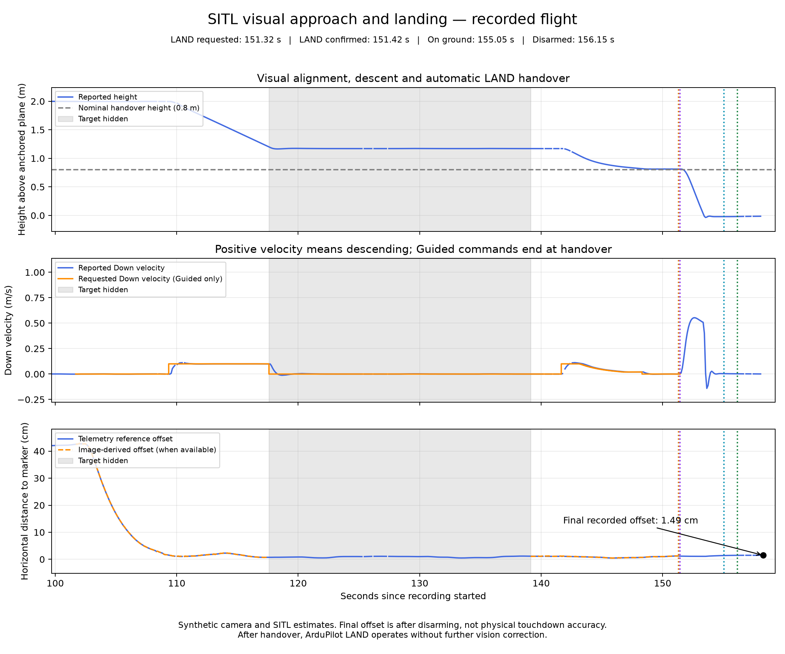

# Results summary

This document reports webcam distance checks and separate synthetic-camera flight tests in ArduPilot SITL. It does not report physical drone landing accuracy.

## 1. Webcam distance checks

Marker size: 5.25 cm. Calibration session: `session_20261109_175221_567046`.

Source: `position_checks/position_20261109_180114_708409.csv`. Analysis report: `position_checks/reports/distance_validation_20261109_180114.txt`.

| Ruler reference | Saved readings | Mean estimate | Mean signed error | Relative error |
|---|---:|---:|---:|---:|
| 30 cm | 5 | 31.13 cm | +1.13 cm | +3.77% |
| 40 cm | 5 | 41.54 cm | +1.54 cm | +3.86% |
| 50 cm | 10 | 52.84 cm | +2.84 cm | +5.68% |

The estimates were higher than the manually measured references. No correction multiplier was applied. These were three short, near-centred capture groups, not independent repeated positioning trials. Ruler placement, marker measurement, focus, reflections and calibration can contribute to error; the individual causes were not isolated.

## 2. Controlled descent tests

Three SITL runs reached the completion hover near 0.8 m. Across four recorded target-loss intervals, the logs reported zero nonzero velocity commands during target loss. Subsequent reacquisition allowed the sequence to continue.

| Run ID | Hidden interval | Maximum sampled horizontal displacement from interval start | Height span after first 2 s |
|---|---:|---:|---:|
| `20261110_115715_509084` | 7.141 s | 1.139 cm | 0.290 cm |
| `20261110_115715_509084` | 4.128 s | 0.872 cm | 0.254 cm |
| `20261110_122132_151613` | 13.083 s | 1.111 cm | 0.438 cm |
| `20261110_122659_502281` | 6.944 s | 0.668 cm | 0.379 cm |

Sources: matching `sitl_descent_logs/descent_<run ID>.csv` files and `sitl_descent_reports/descent_<run ID>_review.txt` reports.

The first two seconds are excluded only for a diagnostic comparison of later behaviour; this is not a formal settling-time criterion. Test durations and starting heights differed. These observations show similar behaviour across the recorded cases, not a controlled statistical repeatability study. Completion at this stage was a hover above ground, followed by manual landing.

## 3. Automatic LAND handover

Both recorded handover runs confirmed LAND mode, on-ground status and disarming. Final offset is the last fresh local-position horizontal distance to the fixed simulated marker at success confirmation, after disarming. It is not exact touchdown error.

| Run ID | Case | Result | Final simulated offset |
|---|---|---|---:|
| `20261110_203109_703383` | Baseline | Ground and disarming confirmed | 2.06 cm |
| `20261110_204642_733626` | Target hidden during descent, then restored | Ground and disarming confirmed | 1.49 cm |

Sources: matching CSV and JSON files under `sitl_landing_logs/`.

### Event sequence for the target-loss run

Times are seconds since recording began, including setup and manual takeoff.

| Event | Time |
|---|---:|
| Target-loss state begins | 117.595 s |
| Target confirmation resumes | 139.139 s |
| LAND requested | 151.322 s |
| LAND mode confirmed | 151.422 s |
| On-ground status confirmed | 155.047 s |
| Disarming confirmed | 156.153 s |
| Success confirmed with fresh position | 158.265 s |

### Target-loss movement and command review

| Check | Recorded value |
|---|---:|
| Target-loss interval duration | 21.544 s |
| Zero-velocity commands logged during the interval | 214 |
| Nonzero velocity commands logged during the interval | 0 |
| Fresh unique position samples | 211 |
| Horizontal net displacement | 0.599 cm |
| Maximum horizontal displacement from interval start | 0.774 cm |
| Height at first / last hidden sample | 1.2003 / 1.1706 m |
| Net height decrease | 2.966 cm |
| Height span across the hidden interval | 3.574 cm |
| Height span after the first 2 seconds | 0.398 cm |
| LAND request rows | 1 |
| Guided velocity commands after the LAND-request row | 0 |

The initial downward velocity was approximately 0.0994 m/s. Height continued to decrease briefly after the stop request, consistent with braking. Later height variation was smaller. A zero command did not mean the drone stopped instantly.

The LAND-request row may contain the final zero-velocity command sent before requesting LAND. The subsequent rows were checked separately and contained no Guided velocity commands. The final CSV row reported LAND mode, disarmed state, on-ground status and fresh telemetry. Recomputing the horizontal distance from the saved North/East coordinates gave 1.492 cm, matching the JSON summary.

### Final graph

The image-derived offset disappears while the target is hidden. The telemetry reference remains available because the simulated marker location is known. After handover, ArduPilot LAND operates without further vision correction.

## 4. What these results demonstrate

- Webcam marker detection and measured distance comparisons.
- Image-derived alignment and controlled descent in the tested synthetic-camera/SITL setup.
- Logged zero-velocity requests during target loss, followed by reacquisition and resumed descent.
- Automatic LAND handover with separate mode, ground and disarming confirmation.
- Recording and review of requested commands, reported movement and final offset.

## 5. Limits

- Webcam testing and SITL flight testing were separate; no physical camera guided a real drone.
- The synthetic camera and estimator share ideal geometry assumptions.
- Position and velocity values are autopilot estimates in simulation, not independent physical measurements.
- The logs are sampled. They may miss motion between samples; summing small position changes is not the same as net drift.
- Hidden intervals follow logged states, not exact key-press timestamps.
- Two successful handover runs do not establish a general success rate or centimetre-level real-world accuracy.
- Hardware integration, environmental testing and supervised real flight remain future work.

## Conclusion

The tested system completed a vision-guided simulated approach and descent, handled temporary target loss, and handed control to ArduPilot LAND. Ground and disarming confirmation were logged in both completed handover runs. The next step for this version is documentation and reproducible packaging; real-drone deployment remains a separate development stage.
